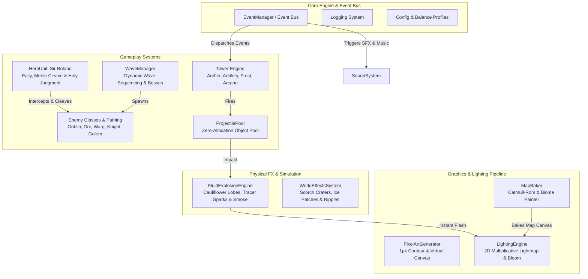

# Tower Defense II — Royal Guard (Tactical Pixel-Art Edition)

[](https://www.python.org/)
[](https://www.pygame.org/)
[](https://opensource.org/licenses/MIT)
[]()
[]()

A modular, commercial-grade 2D fantasy tower defense game built from scratch in **Python** and **Pygame**. Inspired by tactical lane-defense classics like *Kingdom Rush*, it features a custom **Procedural Pixel-Art Engine**, **Real-Time 2D Dynamic Lighting & Additive Bloom Pipeline**, **Fluid Multi-Frame Explosion Physics**, a **Controllable Royal Paladin Hero**, and **3 Distinct Procedural Fantasy Biomes**—rendered 100% in code without reliance on external pre-rendered sprite sheets.

---

## Architecture & Engineering Highlights



### Key Architectural Pillars

1. **Procedural Pixel-Art Generator (`graphics/pixel_gen.py`, `graphics/map_baker.py`):**
   - Renders multi-layered sprites onto low-resolution virtual canvases with automatic dark contouring (`apply_pixel_outline`), directional shading, and crisp nearest-neighbor integer scaling.
   - Bakes complete fantasy maps procedurally across 3 biomes with Catmull-Rom spline cobblestone paths, bridges, winding waterways, animated foliage, and the Royal Castle.
2. **Real-Time 2D Dynamic Lighting & Bloom (`graphics/lighting.py`):**
   - Seamless Day $\rightarrow$ Sunset $\rightarrow$ Night progression across campaign waves (or manual mode toggling via **`[L]`**).
   - Multiplicative ambient lightmap (`BLEND_RGB_MULT`) combined with an additive HDR-style bloom pass (`BLEND_RGB_ADD`) for glowing spires, hero holy aura, castle torches, spawn portals, Boss Golem magma core, molten lava, projectiles, and falling meteors.
3. **Fluid Procedural Explosion Engine (`systems/particles.py`):**
   - **Directional Ground Blast & Upward Mushroom Plume:** Simulates ground kinetic deflection that channels energy upward into a boiling, organic chimney plume with cauliflower micro-offsets and hypersonic starburst flame tendrils.
   - **Volumetric Multi-Pass Color Evolution:** Transitions smoothly from a blinding white-hot ignition core (`t < 0.24`) to saturated fiery orange/crimson, cooling into rich amber and expanding into rolling charcoal smoke with lingering internal embers before dissolving with per-pixel alpha falloff.
   - **High-Velocity Tracer Sparks with Motion Blur:** Incandescent shrapnel sparks render as dynamic velocity streaks along their flight vectors with glowing white heads, air drag, and parabolic gravity arcs.
   - **Thematic Elemental FX:** Tailored visual profiles for **Roaring Fire** (Artillery mortars, Meteor strikes), **Glacial Frost Nova** (Frost Spire, Royal Blizzard with icy cyan mist and shattered crystal shards), and **Radiant Holy Burst** (Sir Roland's Holy Judgment with solar ray bursts and consecrated golden dust).
4. **Controllable Hero Unit — Sir Roland the Royal Paladin (`gameplay/hero.py`):**
   - Real-time command via **Right Click** or **`[H]`** to reposition anywhere across the battlefield.
   - Intercepts and blocks marching enemies in close melee combat with cleaving sword strikes that damage surrounding foes.
   - Persistent leveling system (Levels 1 to 5) that boosts Max HP and attack damage through combat XP.
   - **`[E]` Holy Judgment Skill:** Slams the ground with a consecrated golden sigil, healing the hero, dealing heavy AoE magic damage, and slowing all caught enemies.
5. **Living World & Persistent Battlefield Decals (`systems/world_fx.py`):**
   - Persistent fading ground decals: artillery/meteor scorch craters, frost spire ice patches, holy judgment sigils, and combat splats.
   - Animated river/lava current foam ripples, wind-blown biome foliage/embers, and glowing night fireflies.
6. **Software Design Patterns:**
   - **Observer / Event Bus (`core/events.py`):** Decouples gameplay logic, sound synthesis, and UI transitions via `EventManager`.
   - **Strategy Pattern (`gameplay/strategy.py`):** Selectable per-tower targeting modes (`First`, `Strongest`, `Weakest`, `Nearest`).
   - **Object Pool Pattern (`gameplay/projectiles.py`):** Recycles projectile instances via `ProjectilePool` to eliminate GC allocation spikes during intense wave combat.

---

## 3 Procedural Biomes

| Biome | Atmosphere & Environment | Hazards & Visual Features |
| :--- | :--- | :--- |
| **Emerald Grasslands** | Lush royal meadows crossed by an azure river and oak groves | Floating leaf particles, clear water ripples, stone bridges |
| **Frozen Tundra** | Snow-dusted northern pass with a glacial blue stream and frost pines | Blizzard flurries, icy frost paths, chilly blue lightmap |
| **Volcanic Ashlands** | Scorched obsidian crags split by an incandescent molten lava river | Rising ember particles, burning trees, volcanic glow bloom |

---

## Project Structure

```text
├── assets/                 # Audio assets (SFX, ambient music loops) and pixel font
├── core/                   # Event bus, logger, balance configuration, and settings loader
├── gameplay/               # Hero unit, spline pathing, towers, enemies, pooled projectiles, waves
├── graphics/               # Procedural pixel-art generator, map baker, 2D lighting, UI kit
├── systems/                # Fluid particle engine, persistent decals, audio controller, score, input
├── ui/                     # Radial build menu, tactical HUD, pause and game over overlays
├── game.py                 # Core game engine, update cycle, and rendering pipeline
├── main.py                 # Application launcher entry point
├── requirements.txt        # Python dependency manifest
├── settings.json           # User configuration (sound volume, keybindings, difficulty)
├── LICENSE                 # MIT License
└── README.md               # Project documentation and architectural overview
```

---

## Installation & Quickstart

### Prerequisites
- **Python 3.10+**
- **Pygame 2.5+**

### Setup
```bash
# Clone repository
git clone https://github.com/btnadgzl/tower_defense.git
cd tower_defense

# Install dependencies
pip install -r requirements.txt

# Run the game
python main.py
# or:
python game.py
```

---

## Controls

| Input / Key | Action |
| :--- | :--- |
| **Left Click** | Select tactical build slots, interact with Radial Menu & HUD buttons |
| **Right Click** | Close active Radial Menu / Command Hero to rally and intercept at cursor |
| **`ESC`** | Close Radial Menu / Toggle Pause Menu |
| **`H`** | Rally Hero to current mouse cursor position |
| **`E`** | Cast Hero Active Skill (**Holy Judgment**) |
| **`1` / `2` / `3` / `4`** | Build Archer / Artillery / Frost / Arcane tower on selected slot |
| **`U`** | Upgrade selected tower to next tier (Lv.2 / Lv.3) |
| **`T`** | Cycle selected tower's targeting strategy (`First` / `Strongest` / `Weakest` / `Nearest`) |
| **`S` / `Backspace`** | Sell selected tower (75% gold refund) |
| **`L`** | Cycle Dynamic 2D Lighting mode (`Auto Cycle` / `Daylight` / `Sunset` / `Night`) |
| **`N`** | Call next wave early (grants Early Wave Gold Bonus) |
| **`Space`** | Toggle game speed (`1x` / `2x`) |
| **`Q` / `W`** | Cast **Meteor Shower** (`Q`) / **Royal Blizzard** (`W`) |

---

## License

This project is licensed under the terms of the [MIT License](LICENSE).  
Copyright (c) 2026 Batin Adiguzel.
